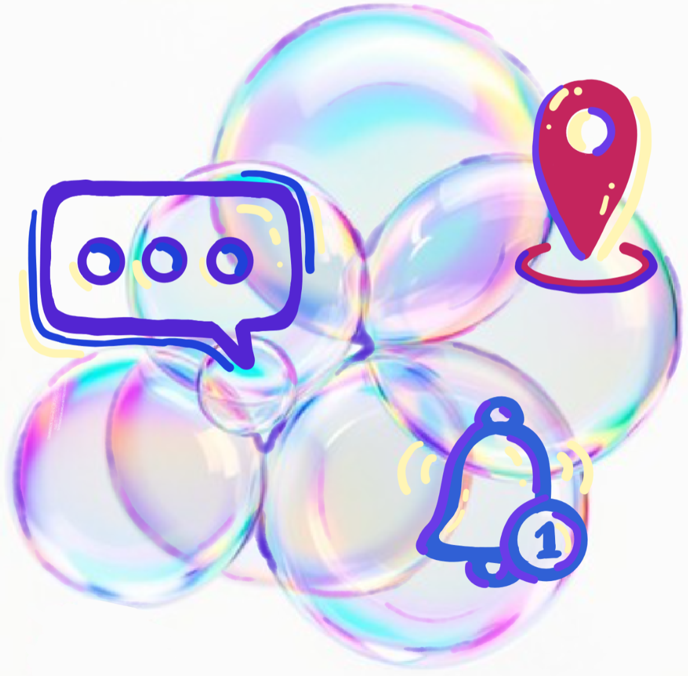

# Bubbles

Bubbles is a social location-sharing app for friends, families and clubs. Each group is a **Bubble**: its members see each other on a map and share pins, events and alerts. Everything shared in a Bubble stays inside it.

COMP 451 capstone project for Smith Micro, by Sydney Goettel, Sam Mayfield, Tim Shin and Yina Tang.

## Features

- **Bubbles:** create a group, pick its color and icon, and invite people. Only the Bubble's creator can invite members. Switch between Bubbles, or see everyone at once.
- **Live map:** members' locations, grouped when they overlap, with markers at the screen edge for people out of view.
- **Pins:** drop a pin on a place worth visiting, give it a category and a rating, and share it to a Bubble. Browse the best-rated pins by activity (food, outdoors, study…).
- **Hotspots:** a named area on the map, such as Home or Campus. Get an alert when chosen members arrive or leave.
- **Events:** plan an event in a Bubble, with RSVPs and a reminder.
- **Quick messages:** one-tap texts such as "On my way!" that open the phone's Messages app.
- **Inbox:** invites, alerts and event updates, with read and unread states.
- **Profile:** photo, bio, hobbies, links, friends and your top pins. Your profile color becomes the app's accent color.

## Repository

| Folder | What's in it |
|---|---|
| [`ui-prototype/`](ui-prototype/) | Clickable React Native (Expo) prototype with dummy data, used for user testing. See its [README](ui-prototype/README.md) to run it. |
| [`docs/`](docs/) | Project report and style guide |
| [`requirements/`](requirements/) | Course assignments |
| `frontend/`, `backend/` | Production app (not started) |

## Status

The UI prototype is on version 2, on the `setup/ui-prototype` branch. Version 2 reworks the prototype after user testing of version 1 (tag `v1.0`), with Hotspots, pin categories, creator-only invites and a new map and navigation. Production development has not started.
