# Bubbles ER Diagram

The data model behind the app, normalized from the prototype's dummy data (`ui-prototype/data.ts`) for a real backend. The same model as an image: [PNG](images/er-diagram.png), [SVG](images/er-diagram.svg).

```mermaid
erDiagram
    USER ||--o| LOCATION : "shares"
    USER ||--o{ USER_LINK : "lists"
    USER ||--o{ USER_HOBBY : "has"
    USER ||--o{ PHOTO : "uploads"
    USER ||--o{ BUBBLE : "owns"
    USER ||--o{ MEMBERSHIP : "joins"
    BUBBLE ||--o{ MEMBERSHIP : "has"
    BUBBLE ||--o{ INVITE : "sends"
    USER ||--o{ INVITE : "invites / is invited"
    BUBBLE ||--o{ HOTSPOT : "defines"
    HOTSPOT ||--o{ HOTSPOT_ALERT : "triggers"
    USER ||--o{ HOTSPOT_ALERT : "watches / is watched"
    BUBBLE ||--o{ PIN : "holds"
    USER ||--o{ PIN : "drops"
    PIN ||--o{ PIN_RATING : "gets"
    USER ||--o{ PIN_RATING : "rates"
    PIN ||--o{ PHOTO : "shows"
    BUBBLE ||--o{ EVENT : "plans"
    USER ||--o{ EVENT : "hosts"
    EVENT ||--o{ RSVP : "gets"
    USER ||--o{ RSVP : "answers"
    BUBBLE ||--o{ ACTIVITY : "logs"
    USER ||--o{ ACTIVITY : "does"
    USER ||--o{ NOTIFICATION : "receives"
    USER ||--o{ SOS_ALERT : "sends"
    BUBBLE ||--o{ SOS_ALERT : "notifies"

    USER {
        uuid id PK
        string name
        string handle UK
        string phone UK
        string bio
        string avatar
        string accent_color
        bool sharing_on "app-wide; off overrides every Bubble"
        bool notifications_on "app-wide"
        timestamp created_at
    }
    LOCATION {
        uuid user_id PK, FK
        float lat
        float lng
        string place_label
        bool moving
        timestamp updated_at
    }
    USER_LINK {
        uuid id PK
        uuid user_id FK
        string kind "Instagram, Strava, Website..."
        string url
    }
    USER_HOBBY {
        uuid user_id PK, FK
        string hobby PK
    }
    BUBBLE {
        uuid id PK
        uuid owner_id FK "only the owner can invite"
        string name
        string about
        string color
        string icon
        bool is_public "public = findable; content stays members-only"
        timestamp created_at
    }
    MEMBERSHIP {
        uuid bubble_id PK, FK
        uuid user_id PK, FK
        bool muted
        bool sharing_paused
        timestamp joined_at
    }
    INVITE {
        uuid id PK
        uuid bubble_id FK
        uuid inviter_id FK
        uuid invitee_id FK
        string status "pending, accepted, declined"
        timestamp created_at
    }
    HOTSPOT {
        uuid id PK
        uuid bubble_id FK
        uuid created_by FK
        string name
        string icon
        float lat
        float lng
        int radius_m
    }
    HOTSPOT_ALERT {
        uuid hotspot_id PK, FK
        uuid watcher_id PK, FK "who gets notified"
        uuid member_id PK, FK "whose arrivals count"
        bool on_arrive
        bool on_leave
    }
    PIN {
        uuid id PK
        uuid bubble_id FK
        uuid created_by FK
        string name
        string note
        string category "Food, Coffee, Outdoors..."
        float lat
        float lng
        string address
        timestamp created_at
    }
    PIN_RATING {
        uuid pin_id PK, FK
        uuid user_id PK, FK
        int stars "1 to 5"
    }
    PHOTO {
        uuid id PK
        uuid user_id FK
        uuid pin_id FK "null for profile photos"
        string url
        string caption
    }
    EVENT {
        uuid id PK
        uuid bubble_id FK
        uuid host_id FK
        string title
        timestamp starts_at
        string place_name
        string address
        float lat
        float lng
    }
    RSVP {
        uuid event_id PK, FK
        uuid user_id PK, FK
        string status "going, maybe, cant_go"
        bool remind
    }
    ACTIVITY {
        uuid id PK
        uuid bubble_id FK
        uuid actor_id FK
        string kind "arrived, left, pinned, event..."
        string text
        timestamp created_at
    }
    NOTIFICATION {
        uuid id PK
        uuid recipient_id FK
        string kind "invite, hotspot, event, pin, sos"
        string title
        string body
        bool read
        uuid invite_id FK "what tapping opens; one is set"
        uuid event_id FK
        uuid pin_id FK
        uuid hotspot_id FK
        timestamp created_at
    }
    SOS_ALERT {
        uuid id PK
        uuid user_id FK
        uuid bubble_id FK
        float lat
        float lng
        uuid resolved_by FK
        timestamp created_at
        timestamp resolved_at
    }
```

## Notes

- **Everyone** isn't stored: it's every Bubble you belong to, merged.
- **Friends** aren't stored: they're everyone you share at least one Bubble with.
- **Privacy:** a member sees another member's location, pins, photos and events only through a Bubble they both belong to, and only while that member's sharing is on, both app-wide (`USER.sharing_on`) and for that Bubble (`MEMBERSHIP.sharing_paused`).
- **Hotspot alerts** are per person: each member picks whom they're alerted about, and for arrivals, departures or both.
- **Pin ratings** are one row per person, so the average and count come from `PIN_RATING`.
- **Messaging** isn't modeled: quick messages open the phone's Messages app.
